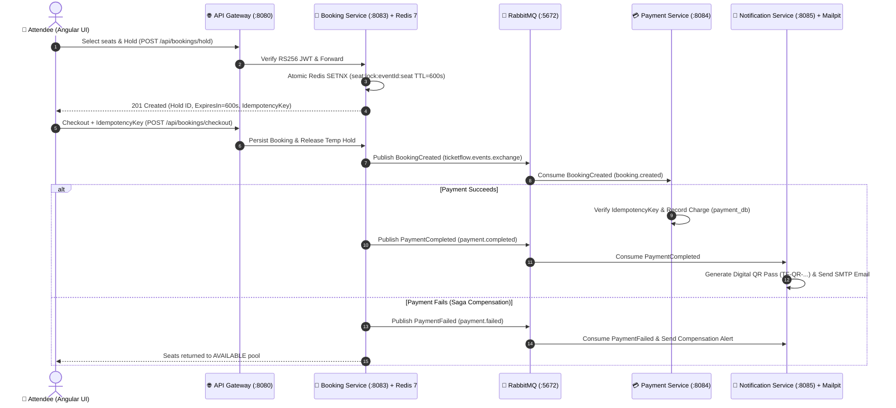

# 🎟️ TicketFlow — Cloud-Native Event Ticket Booking Platform

[](https://github.com/Chathuka-2003/ticketflow/actions/workflows/ci.yml)


**TicketFlow** is an enterprise-grade, cloud-native, microservices-based event ticket booking platform engineered for **high-concurrency flash-sale drops**. Built with **6 Spring Boot microservices (Java 21)**, **Spring Cloud Gateway**, **PostgreSQL 16 (Database-per-Service + Flyway)**, **Redis 7**, **RabbitMQ 3**, and a modern **Angular SPA** served via a **non-root Nginx container**, it includes complete **Observability (Prometheus + Grafana)**, **CI/CD (GitHub Actions + Jenkins + Trivy)**, **Kubernetes + Helm + HPA**, and **Terraform AWS EKS / RDS / ElastiCache / ECR** automation.

---

## 📋 Table of Contents

- [✨ Core Engineering Highlights](#-core-engineering-highlights)
- [🏛️ System Architecture & Saga Flow](#️-system-architecture--saga-flow)
- [🧩 Microservices & Infrastructure Matrix](#-microservices--infrastructure-matrix)
- [🔐 Zero-Trust Security & RBAC](#-zero-trust-security--rbac)
- [🗂️ Repository Structure](#️-repository-structure)
- [🚀 Quick Start (Docker Compose)](#-quick-start-docker-compose)
- [📊 Observability (Prometheus & Grafana)](#-observability-prometheus--grafana)
- [🔄 CI/CD Pipelines (GitHub Actions & Jenkins)](#-cicd-pipelines-github-actions--jenkins)
- [☸️ Kubernetes & Helm Deployment](#️-kubernetes--helm-deployment)
- [☁️ AWS Cloud Deployment (Terraform: EKS + RDS + ElastiCache + ECR)](#️-aws-cloud-deployment-terraform-eks--rds--elasticache--ecr)
- [⚡ Load Testing (k6) & E2E Smoke Tests](#-load-testing-k6--e2e-smoke-tests)
- [🔑 Demo Credentials](#-demo-credentials)
- [📚 Additional Documentation](#-additional-documentation)

---

## ✨ Core Engineering Highlights

- 🏟️ **Interactive Arena Seat Map & Atomic 10-Minute Redis TTL Lock**:
  - Real-time SVG seat map across tiered sections (`VIP Front Row`, `Golden Circle`, `Grandstand`).
  - Uses atomic `SETNX` locks (`seat:lock:<eventId>:<seatLabel>`) with a **600-second (10-minute) TTL** in Redis 7 to prevent double-booking under flash-sale contention, returning `HTTP 409 Conflict` to competing buyers and automatically rolling back partial batch locks.
- 🔁 **Event-Driven RabbitMQ Saga Choreography & Compensation**:
  - Decouples booking, payment, and notification workflows via `ticketflow.events.exchange`:
    1. `booking-service` persists the booking and publishes `BookingCreated`.
    2. `payment-service` consumes `BookingCreated`, enforces strict **idempotency** (`idempotency_key` in `payment_db`), and records the charge (or processes `POST /api/payments/webhook/stripe`).
    3. `notification-service` consumes `PaymentCompleted` / `PaymentFailed`, generates a **Digital QR Pass (`TF-QR-...`)**, and dispatches real **SMTP emails** (captured in **Mailpit** locally).
    4. On payment failure, **Saga Compensation** releases Redis seat locks back to the `AVAILABLE` pool and dispatches a compensation alert.
- 🎨 **Role-Protected Organizer Studio (`ROLE_ORGANIZER` / `ROLE_ADMIN`)**:
  - Create venues with capacity limits, build multi-tier events, save drafts (`DRAFT`), publish live (`PUBLISHED`), or cancel (`CANCELLED`).
- 🔐 **OAuth2 / JWKS Zero-Trust Security**:
  - Asymmetric **RS256** JWTs signed by `auth-service` (`15m` expiry), verified via `/.well-known/jwks.json` at `api-gateway` and downstream microservices, with rotating SHA-256 `HttpOnly` refresh cookies (`7d` expiry).
- 🐳 **Immutable Non-Root Nginx Frontend Container**:
  - Multi-stage Docker build (`node:24-alpine` → `nginx:1.27-alpine` non-root on `:8080`) with gzip, SPA routing fallback, dynamic Docker DNS `/api/` reverse proxy, and `envsubst` runtime `env.js` injection.

---

## 🏛️ System Architecture & Saga Flow



---

## 🧩 Microservices & Infrastructure Matrix

| Component | Container Name | Port(s) | Technology / Responsibility | Data Store |
| :--- | :--- | :--- | :--- | :--- |
| 🌐 **Frontend UI** | `ticketflow-frontend` | `4200`, `80` (`8080` internal) | Angular SPA + Non-root Nginx reverse proxy (`/api/*`) + runtime `env.js` | Browser |
| 🚪 **API Gateway** | `ticketflow-gateway` | `8080` | Spring Cloud Gateway MVC, CORS, RS256 JWKS JWT validation, routing | Stateless |
| 🔑 **Auth Service** | `ticketflow-auth` | `8081` | User/Organizer registration, login, RS256 JWTs, `/.well-known/jwks.json`, refresh token rotation | PostgreSQL (`auth_db`) |
| 🎪 **Event Service** | `ticketflow-event` | `8082` | Venues, Events (`DRAFT`/`PUBLISHED`/`CANCELLED`), Ticket Tiers, capacity validation, RBAC | PostgreSQL (`event_db`) |
| 🎫 **Booking Service** | `ticketflow-booking` | `8083` | Redis 10m `SETNX` seat locks, checkout, Saga publisher, booking history & cancellation | PostgreSQL (`booking_db`) + Redis 7 |
| 💳 **Payment Service** | `ticketflow-payment` | `8084` | Idempotent charges, `BookingCreated` RabbitMQ consumer, Stripe webhook (`/webhook/stripe`) | PostgreSQL (`payment_db`) |
| 📧 **Notification Service** | `ticketflow-notification` | `8085` | `PaymentCompleted`/`PaymentFailed` consumer, QR ticket generator, SMTP dispatch | Stateless |
| 🐘 **PostgreSQL 16** | `ticketflow-postgres` | `5432` | Isolated database-per-service (`auth_db`, `event_db`, `booking_db`, `payment_db`) + Flyway | Persistent Volume |
| ⚡ **Redis 7** | `ticketflow-redis` | `6379` | Distributed atomic seat hold locks (`seat:lock:*`) with `600s` TTL | In-Memory |
| 🐇 **RabbitMQ 3** | `ticketflow-rabbitmq` | `5672`, `15672` | Event-driven Saga broker (`ticketflow.events.exchange`) + Management UI | In-Memory / Disk |
| ✉️ **Mailpit** | `ticketflow-mailpit` | `1025`, `8025` | Local SMTP trap & Web Inbox for inspecting QR confirmation emails | In-Memory |
| 📈 **Prometheus** | `ticketflow-prometheus` | `9090` | Scrapes `/actuator/prometheus` from all 6 microservices + evaluates SLO alert rules | TSDB |
| 📊 **Grafana** | `ticketflow-grafana` | `3000` | Auto-provisioned telemetry dashboards (JVM heap, HTTP rates, HikariCP, CPU/Disk) | Provisioned |
| 🤖 **Jenkins (Optional)** | `ticketflow-jenkins` | `8088`, `50000` | Local Jenkins LTS controller (`docker-compose.jenkins.yml`) running `Jenkinsfile` | `jenkins_home` |

---

## 🔐 Zero-Trust Security & RBAC

- **Asymmetric RS256 Signing**: `auth-service` signs `15m` access tokens with an RSA private key and exposes the public key set at `GET /.well-known/jwks.json`.
- **Gateway + Service Enforcement**: `api-gateway` and downstream microservices validate signatures and `iss = "ticketflow-auth"` independently via `NimbusJwtDecoder`.
- **Refresh Token Rotation**: `7d` refresh tokens are stored as SHA-256 hashes in `auth_db.refresh_tokens` and issued via `HttpOnly; SameSite=Strict; Path=/api/auth` cookies.
- **Role-Based Access Control**:
  - `USER`: Search events, lock seats, execute checkout, view bookings, cancel personal bookings.
  - `ORGANIZER`: Create venues, create/edit/publish/cancel own events (`/organizer`).
  - `ADMIN`: Full platform override capabilities.

---

## 🗂️ Repository Structure

```text
ticketflow/
├── .github/workflows/
│   ├── ci.yml                     # Matrix tests (6 services), Docker builds, Trivy CRITICAL CVE scans
│   └── cd-eks.yml                 # AWS OIDC + ECR + Helm continuous delivery workflow
├── docker/postgres/init/          # Initializes auth_db, event_db, booking_db, payment_db
├── docs/
│   ├── architecture.md            # System design & Saga choreography diagrams
│   ├── openapi.yaml               # OpenAPI 3.0 REST API specification
│   └── runbook.md                 # SRE incident response & SLO diagnostic playbooks
├── frontend/ticketflow-ui/        # Angular SPA + Non-root Nginx (:8080) + Multi-stage Dockerfile
├── helm/ticketflow/               # Helm v2 chart (values.yaml, values-prod.yaml, templates/)
├── k8s/                           # Kubernetes manifests (Namespace, ConfigMap, Secrets, Services, HPA, Ingress)
├── load-tests/flash-sale.js       # k6 flash-sale concurrency & Redis SETNX 409 race test
├── monitoring/
│   ├── prometheus.yml             # Scrape config for all 6 Spring Boot microservices
│   ├── alert-rules.yml            # SLO alerts (MicroserviceDown, HighCheckoutLatencyP95, HighHttp5xxErrorRate)
│   └── grafana/                   # Auto-provisioned Prometheus datasource & TicketFlow dashboard JSON
├── scripts/
│   ├── smoke-test.sh              # 7-step automated E2E verification (Auth -> Event -> Redis -> Saga -> Mailpit)
│   ├── deploy-k8s-local.sh        # Minikube deployment helper
│   ├── deploy-aws-eks.sh          # One-command AWS Terraform + ECR push + EKS rollout
│   ├── destroy-aws-eks.sh         # Clean AWS teardown script to stop billing
│   └── start-local.sh / .ps1      # Local startup helpers
├── services/
│   ├── api-gateway/               # Spring Cloud Gateway (:8080)
│   ├── auth-service/              # OIDC / JWKS Auth Service (:8081)
│   ├── event-service/             # Event & Venue Service (:8082)
│   ├── booking-service/           # Redis 10m Seat Hold + Booking Service (:8083)
│   ├── payment-service/           # Idempotent Payment + Stripe Webhook Service (:8084)
│   └── notification-service/      # RabbitMQ + SMTP QR Ticket Pass Service (:8085)
├── terraform/                     # AWS VPC, EKS 1.31, RDS Postgres 16, ElastiCache Redis & ECR IaC
├── docker-compose.yml             # Full 13-container local orchestration
├── docker-compose.jenkins.yml     # Optional local Jenkins LTS controller (:8088)
└── Jenkinsfile                    # Declarative Jenkins CI/CD pipeline
```

---

## 🚀 Quick Start (Docker Compose)

### 1. Start the Full Platform
```bash
docker compose up -d --build
```

### 2. Verify All Containers Are Healthy
```bash
docker compose ps
```

### 3. Access Local Endpoints

| Service | URL | Notes |
| :--- | :--- | :--- |
| 🎨 **TicketFlow Web App** | http://localhost:4200 or http://localhost | Angular SPA + Nginx |
| 🚪 **API Gateway** | http://localhost:8080/actuator/health | Unified REST Gateway |
| 🔑 **Auth Service JWKS** | http://localhost:8081/.well-known/jwks.json | Public RSA Key Set |
| 🎪 **Event Service** | http://localhost:8082/actuator/health | Catalog & Venues |
| 🎫 **Booking Service** | http://localhost:8083/actuator/health | Redis Seat Locks & Checkout |
| 💳 **Payment Service** | http://localhost:8084/actuator/health | Idempotent Payments |
| 📧 **Notification Service** | http://localhost:8085/actuator/health | QR Pass & SMTP Dispatcher |
| ✉️ **Mailpit Web Inbox** | http://localhost:8025 | Inspect sent QR ticket emails |
| 📊 **Grafana Dashboards** | http://localhost:3000 | Login: `admin` / `ticketflow` |
| 📈 **Prometheus** | http://localhost:9090/targets | All 6 targets `UP` |
| 🐇 **RabbitMQ Management** | http://localhost:15672 | Login: `ticketflow` / `ticketflow_secret` |

---

## 📊 Observability (Prometheus & Grafana)

All 6 Spring Boot microservices include `micrometer-registry-prometheus` and expose `/actuator/prometheus`.

- **Auto-Provisioned Dashboard**: `Dashboards → TicketFlow → TicketFlow Platform — Microservices & Saga Telemetry`
- **Useful PromQL Queries for Custom Panels**:
  - **DB Pool Saturation (%)**: `(hikaricp_connections_active / hikaricp_connections_max) * 100`
  - **Pending DB Threads**: `hikaricp_connections_pending`
  - **HTTP Request Rate by Status**: `sum by (instance, status) (rate(http_server_requests_seconds_count[1m]))`
  - **Average HTTP Latency (ms)**: `(sum by (instance, uri) (rate(http_server_requests_seconds_sum[5m])) / sum by (instance, uri) (rate(http_server_requests_seconds_count[5m]))) * 1000`
  - **JVM Heap Usage (%)**: `(sum by (instance) (jvm_memory_used_bytes{area="heap"}) / sum by (instance) (jvm_memory_max_bytes{area="heap"})) * 100`
  - **Host CPU & Disk Usage (%)**: `system_cpu_usage * 100` / `((disk_total_bytes - disk_free_bytes) / disk_total_bytes) * 100`

---

## 🔄 CI/CD Pipelines (GitHub Actions & Jenkins)

### GitHub Actions
- **CI ([ci.yml](file:///home/chathuka/ticketflow/.github/workflows/ci.yml))**: Runs Maven tests against PostgreSQL 16 for all 6 services, builds all 7 Docker images, and scans each image with **Aqua Trivy (`v0.36.0`)** failing on any `CRITICAL` CVE.
- **CD ([cd-eks.yml](file:///home/chathuka/ticketflow/.github/workflows/cd-eks.yml))**: Manual `workflow_dispatch` using AWS OIDC to push to ECR and run `helm upgrade --install` on EKS.

### Jenkins (`Jenkinsfile` + `docker-compose.jenkins.yml`)
```bash
# 1. Start local Jenkins LTS controller on port 8088
docker compose -f docker-compose.jenkins.yml up -d

# 2. Retrieve initial admin password
docker exec ticketflow-jenkins cat /var/jenkins_home/secrets/initialAdminPassword
```
Create a **Pipeline** job (`Pipeline script from SCM` → Git → `https://github.com/Chathuka-2003/ticketflow.git`, branch `*/main`, script `Jenkinsfile`). Supports parameterized `RUN_TRIVY_SCAN` and `DEPLOY_TO_EKS`.

---

## ☸️ Kubernetes & Helm Deployment

### Raw Kubernetes Manifests (`k8s/`)
```bash
# Local Minikube deployment
chmod +x scripts/deploy-k8s-local.sh
./scripts/deploy-k8s-local.sh

# Watch Horizontal Pod Autoscalers (booking-service 2->10, event-service 2->6)
kubectl get hpa -n ticketflow -w
```

### Helm Chart (`helm/ticketflow/`)
```bash
helm upgrade --install ticketflow ./helm/ticketflow \
  --namespace ticketflow \
  --create-namespace \
  -f ./helm/ticketflow/values.yaml
```

---

## ☁️ AWS Cloud Deployment (Terraform: EKS + RDS + ElastiCache + ECR)

Provision the full AWS production stack (`eu-north-1` by default) and deploy all 7 containers:

```bash
# 1. Provision VPC, NAT, 7 ECR repos, RDS Postgres 16, ElastiCache Redis, EKS 1.31 & deploy pods
chmod +x scripts/deploy-aws-eks.sh
./scripts/deploy-aws-eks.sh

# 2. Inspect live AWS Kubernetes resources & public LoadBalancer URL
kubectl get pods,svc,hpa -n ticketflow

# 3. Teardown all AWS resources after demo to avoid ongoing hourly charges
chmod +x scripts/destroy-aws-eks.sh
./scripts/destroy-aws-eks.sh
```

---

## ⚡ Load Testing (k6) & E2E Smoke Tests

### Automated E2E Smoke Test
Exercises the complete live workflow (`Auth → Venue/Event Publish → Redis 10m Seat Hold → Concurrent Buyer 409 Conflict → Idempotent Checkout → RabbitMQ Saga → Payment DB & Mailpit QR Email`):
```bash
chmod +x scripts/smoke-test.sh
./scripts/smoke-test.sh
```

### k6 Flash-Sale Concurrency Test
Simulates a 50-VU catalog traffic spike + 15-VU simultaneous race on seat `A1` (verifying `1` winner receives `201 Created` and `14` receive `409 Conflict`):
```bash
k6 run -e BASE_URL=http://localhost:8080 load-tests/flash-sale.js
```

---

## 🔑 Demo Credentials

1-Click demo login buttons are available directly on the `/login` page:
- **Organizer (`ROLE_ORGANIZER`)**: `organizer@ticketflow.io` / `Password123!`
- **Attendee (`ROLE_USER`)**: `attendee@ticketflow.io` / `Password123!`

---

## 📚 Additional Documentation

- 🏛️ [Architecture & Saga Sequence Diagrams](docs/architecture.md)
- 📜 [OpenAPI 3.0 Specification](docs/openapi.yaml)
- 🩺 [SRE Incident Response Runbook](docs/runbook.md)
