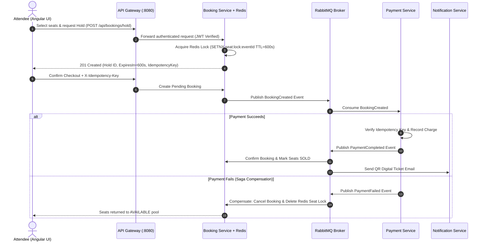

# TicketFlow — Cloud-Native Event Ticket Booking Architecture

## 1. Domain & Engineering Rationale

TicketFlow is designed around high-concurrency event ticket reservations where every architectural and DevOps component solves a concrete distributed-systems problem:

1. **High-Concurrency Seat Reservation (`Redis TTL Lock` + `HPA`)**:
   - Flash-sale concert ticket drops create massive traffic spikes on seat-selection and hold endpoints, justifying Kubernetes Horizontal Pod Autoscaling (HPA) and k6 load testing.
   - Selected seats are locked atomically in Redis with a **10-minute TTL (`600s`)** so two users cannot reserve the same seat simultaneously, while abandoned carts automatically return to the pool when the TTL expires.
2. **Event-Driven Saga Choreography (`RabbitMQ`)**:
   - Decouples booking creation, payment processing, and email notifications across independent microservices (`booking-service` → `payment-service` → `notification-service`), with compensating rollback when a payment fails.
3. **Database-per-Service Isolation (`PostgreSQL 16` + `Flyway`)**:
   - Each service owns its schema (`auth_db`, `event_db`, `booking_db`, `payment_db`) migrated deterministically via Flyway.

---

## 2. Microservices Responsibility Matrix

| Service | Port | Responsibility | Data Store |
| :--- | :--- | :--- | :--- |
| **`frontend` (Nginx + Angular)** | `80` / `4200` (`8080` internal) | Standalone Angular SPA served by non-root Nginx, runtime `API_URL` injection via `envsubst`, reverse proxy `/api/*` | Browser + LocalStorage |
| **`api-gateway`** | `8080` | Spring Cloud Gateway MVC: routing, RS256 JWT verification via JWKS, CORS, stateless security filter | Stateless |
| **`auth-service` (OIDC / JWKS)** | `8081` | User registration, login, RS256 JWT issuance, `/.well-known/jwks.json`, rotating `HttpOnly` refresh token cookies, roles (`USER`, `ORGANIZER`, `ADMIN`) | PostgreSQL (`auth_db`) |
| **`event-service`** | `8082` | Venues, events (`DRAFT`, `PUBLISHED`, `CANCELLED`), ticket tiers, capacity validation, public search & organizer management | PostgreSQL (`event_db`) |
| **`booking-service`** | `8083` | 10-minute Redis seat hold (`seat:lock:<eventId>`), booking lifecycle (`HELD` → `CONFIRMED` / `CANCELLED`) | PostgreSQL (`booking_db`) + Redis |
| **`payment-service`** | `8084` | Idempotent payment processing (`X-Idempotency-Key`), publishes `PaymentCompleted` / `PaymentFailed` events | PostgreSQL (`payment_db`) |
| **`notification-service`** | `8085` | Consumes booking & payment events from RabbitMQ and dispatches confirmation emails with QR passes | Stateless |

---

## 3. Core Booking & Saga Choreography Flow

---

## 4. Security & Zero-Trust JWT Architecture

- **Asymmetric RS256 Signing**: `auth-service` signs access tokens (`15m` expiry) with an RSA private key and exposes the public key set at `GET /.well-known/jwks.json`.
- **Gateway & Service Validation**: Both `api-gateway` and `event-service` configure Spring Security OAuth2 Resource Server with `NimbusJwtDecoder` pointing to `http://auth-service:8081/.well-known/jwks.json` and validate `iss = "ticketflow-auth"`.
- **Refresh Token Rotation**: Refresh tokens (`7d` expiry) are stored as SHA-256 hashes in `auth_db.refresh_tokens` and delivered via `HttpOnly; SameSite=Strict; Path=/api/auth` cookies. Every `/api/auth/refresh` call rotates the token and revokes the previous hash.
- **Role-Based Access Control (RBAC)**:
  - `USER`: Search events, hold seats, checkout, manage personal bookings.
  - `ORGANIZER`: Create venues, create/edit/publish/cancel own events (`/api/events/mine`, `/organizer` route).
  - `ADMIN`: Full platform override capabilities.

---

## 5. Frontend & Non-Root Nginx Container Design

- **Directory**: `frontend/ticketflow-ui`
- **Architecture**: Angular standalone components with Angular Signals, functional `HttpInterceptorFn` (`authInterceptor`), functional route guards (`authGuard`, `organizerGuard`), and interactive SVG arena seat maps.
- **Runtime Environment Injection**:
  - `public/env.template.js` is processed at container startup by `/docker-entrypoint.sh` using `envsubst '${API_URL} ${KEYCLOAK_ISSUER}' > /usr/share/nginx/html/env.js`.
  - Allows the exact same immutable Docker image (`ticketflow/frontend`) to run in local Docker Compose, staging, and production AWS EKS clusters simply by changing environment variables.
